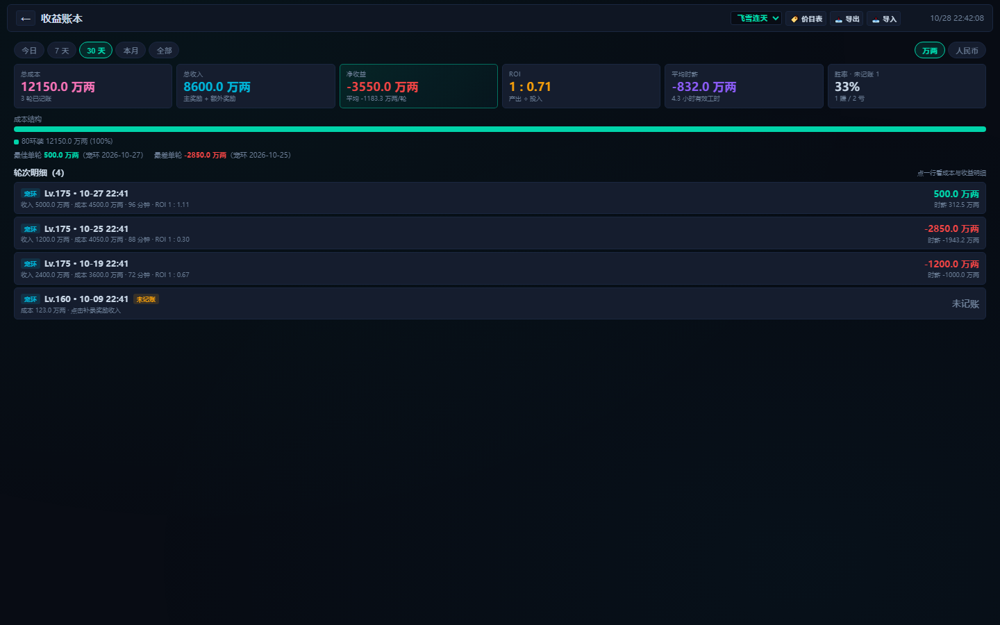
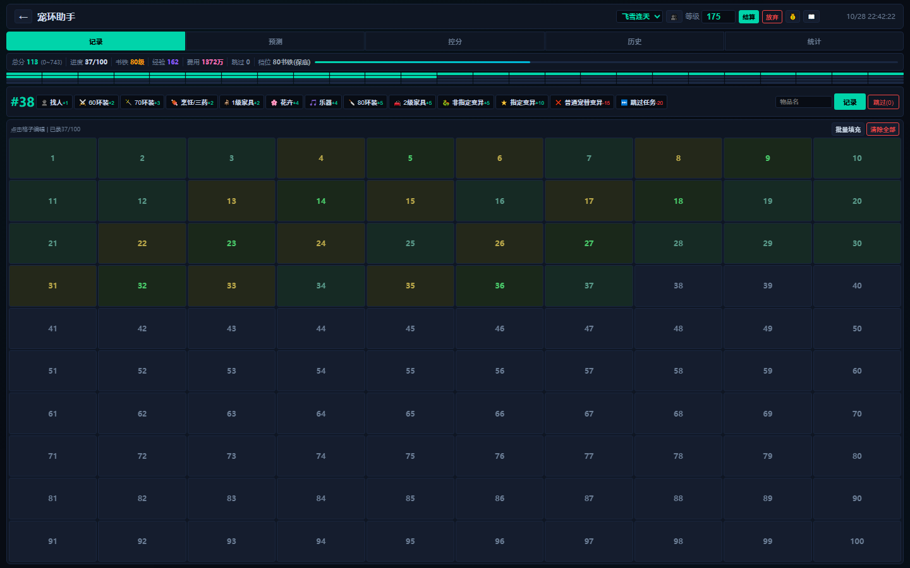

# 梦幻搞钱工具箱（PC 单页版）

跑环记录 + 收益账本。一个 `index.html` 打开就能用，不装环境、不连服务器，数据只存在浏览器本地。

> 版本 v0.2.1 · 2026-10-28。规划与取舍见 [移植规划-v0.1.md](移植规划-v0.1.md)。


## 1. 它解决什么问题

跑环最烦的不是记环数，是记完之后算不清这一轮到底赚没赚。这个版本把记录和算账接成了一条线。

每录一环，花了多少当场算进这一轮的成本。100 环或 300 环跑完，在结算弹窗里勾一下实际拿到的书铁和额外奖励，成本、收入、利润、ROI、时薪一起出来。这些数字会存进账本，过几天回头翻，能看出哪几轮真划算、哪几轮是在白忙。



## 2. 快速开始

单文件，双击 `index.html` 就能用。想用本地服务（避免个别浏览器对 `file://` 的限制）：

```bash
cd mhxy-getcash-box
python -m http.server 8899
# 打开 http://127.0.0.1:8899/index.html
```

第一次打开会有一个欢迎页，关了就能用。数据在 `localStorage`，换浏览器 / 清缓存就没了，记得用「导出」备份。

## 3. 功能

### 宠环（100 环）

逐环记录任务类型与物品名，实时算总分、书铁等级、修炼经验、本轮费用和已用时长。本轮可以随时暂停，暂停的时间不算进时薪。

录入有两套操作方式。鼠标点快速栏，或者用键盘：`1`~`9` 直接选中常用任务，`Enter` 记录，`←` `→` 切标签页，`Esc` 关弹窗。快速栏会按你用得最多的顺序重排，输入过的物品名会留成 chips，点一下回填。环格上方的「环号」输入框能直接跳到第 N 环并高亮。

预测页给出各档书铁需要的分数，控分页算每环还差几分、可行性；历史与统计（得分趋势图、档位分布）。



### 人环（300 环）

300 环记录，100 / 200 / 300 三段分别记奖励，按角色等级给出书铁区间与灵饰、战魄的可能性；统计页看任务类型分布与费用。

### 收益账本

结算时按类别、等级、类型选书铁，价目表自动给价，勾上修炼果或家具图就直接算进收入。

填完能立刻看到这一轮的成本、收入、利润、ROI 和时薪。额外成本、自定义收入、用时都可以手填，数字不对就当场改。

账本页把最近几轮摊开：六张 KPI 卡是总成本、总收入、净收益、ROI、平均时薪、胜率，下面是成本结构条形图和逐轮列表，点一行能看到这一轮的成本明细与收入明细。

没有收入字段的老记录会标「未记账」。点进去补个数字就进账，不用重新录一遍。

### 金价与价目表

首页金价计算器默认 `3000 万两 = 202 元`，改成你区服的比例后保存；账本里可以在万两和人民币之间切换。

旁边还能设一个目标时薪（默认 10 元/时）。设完之后，结算预览和账本的平均时薪都会告诉你这一轮达标没有，差多少。
奖励参考价在「奖励价目表」里按等级改，单位万两，改完只影响之后新结算的轮次。

### 数据

- 可以开多个角色，各自的记录和账本分开存，标题栏下拉就能切换
- 点「导出」会把所有角色的记录、价目表、金价比例打包成一个 JSON 存下来。
- 导入时既认这份新格式，也认 Web 旧版的单工具导出（`{type,hist,cfg,prices,cur}`）
- 撤销栈保留最近 10 步记录操作

## 4. 键盘操作（PC 上更快）

| 按键 | 作用 |
|---|---|
| `1` ~ `9` | 选中快速栏第 1~9 个任务（按常用度排序后的顺序） |
| `Enter` | 记录当前选中的任务 |
| `←` `→` | 切换记录 / 预测 / 控分 / 历史 / 统计 |
| `Esc` | 关闭最上层弹窗 |

输入框里打字时不会触发这些键。

## 5. 字号与缩放（大屏别凑太近）

界面字号跟着屏宽走，不用改系统缩放：

| 屏宽 | 默认缩放 | 13px 正文实际显示 |
|---|---|---|
| < 1600 | 100% | 13px |
| ≥ 1600 | 112% | 14.6px |
| ≥ 1920（1K） | 128% | 16.6px |
| ≥ 2400（2K） | 145% | 18.9px |
| ≥ 3400（4K） | 170% | 22.1px |

还是嫌小或嫌大，点右上角的 **Aa** 按钮手动锁档：115% → 130% → 145% → 160% → 175% → 回到「自动」。选完记在本机，下次打开还是这个档。缩放同时作用于字号和弹窗宽度，不会出现字大了框没大的情况。

## 6. 技术说明

单文件 HTML 加原生 JS，没有运行时依赖。`index.html` 里 `/* @core:start */ … /* @core:end */` 之间放的是纯数据和纯函数（公式、估值、汇总），Node 测试把这一段抽出来跑，不用碰 DOM。

```bash
npm test        # 18 项公式与账本口径单测（node --test）
npm run smoke   # 56 项浏览器行为冒烟（jsdom，覆盖记录→结算→账本→补录→键盘→缩放）
```

单测覆盖的口径（这些是最容易算错钱的地方）：

| 口径 | 规则 |
|---|---|
| 书铁等级 | `总分 + floor(等级/3) - 130`，向下取整到 10，范围 80~150 |
| 修炼经验 | 每环经验表累加，满环 **751**（不是 760） |
| 人环奖励区间 | 等级±10，≥140 固定 130~140，≥156 才有 150/战魄，全部对齐到 10 的倍数 |
| 价格 | 显式设 0 就是免费，不回退默认价；没设过才用默认价 |
| 账本 | 利润 = 收入 - 成本；ROI = 收入 / 成本；时薪 = 利润 ÷ 用时（不足 5 分钟不给时薪） |

## 7. 目录

```
index.html                 单页应用（也是唯一的运行文件）
移植规划-v0.1.md           这次从 Web 版和小程序搬了什么、为什么不搬什么
scripts/extract-core.js    从 index.html 抽 @core 区间给 Node 用
tests/core.test.js         公式与账本单测
tests/smoke-dom.js         jsdom 行为冒烟
docs/screenshots/          README 用图
```

## 8. 已知限制

- 数据只在本机浏览器里，没有云同步，也没有账号体系。换设备得先用导出文件带过去
- 奖励价目表和任务单价是参考值，各区各服差异大，建议先按自己区服改一遍
- 人环三段奖励按文字解析估值，自己手输的怪名字会落到「其他」里、估值为 0，可以在结算的「自定义收入」里补
- 没有分享海报，也不跟小程序做数据互通——这两条是明确排除的，别指望后面的版本会加
- 每日快照、历史归档、点卡成本还没做

## 9. License

MIT
