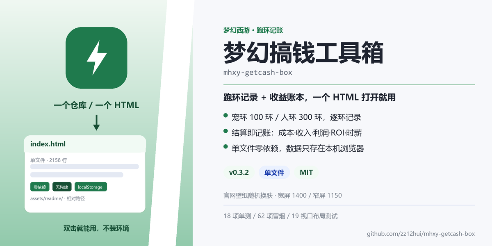
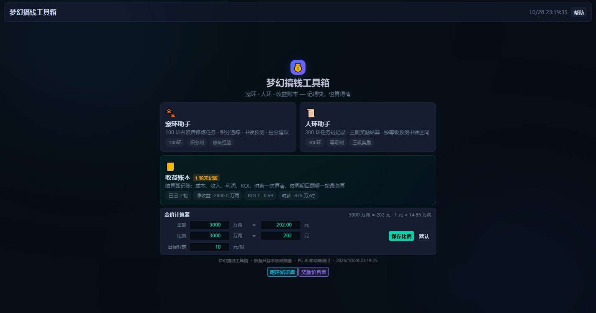
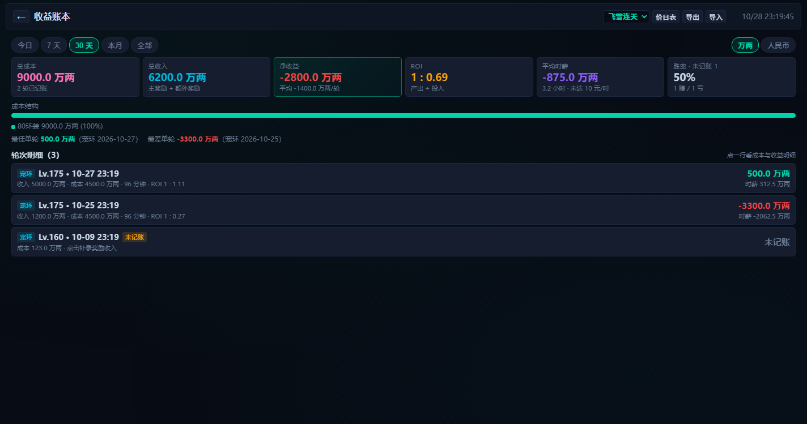
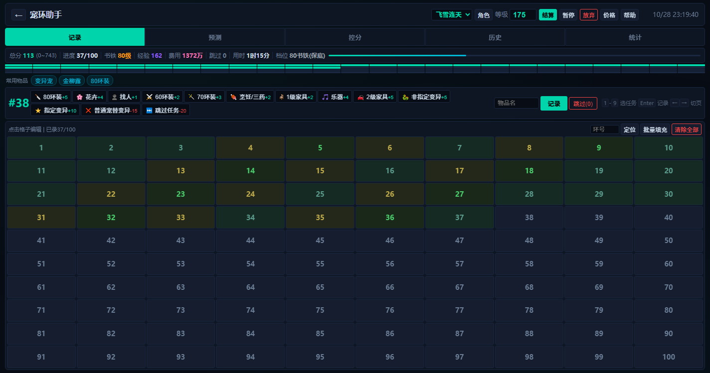
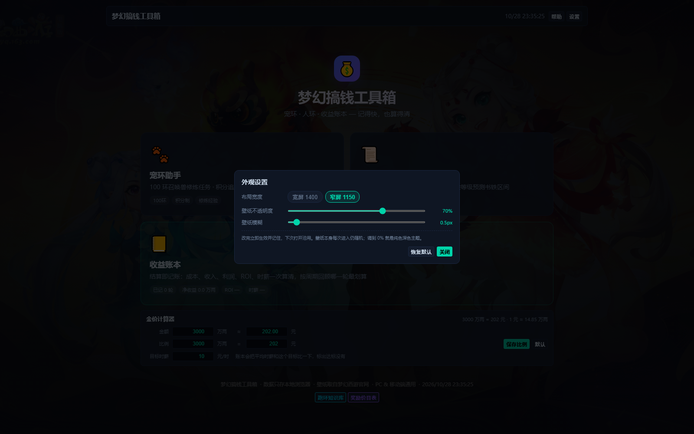
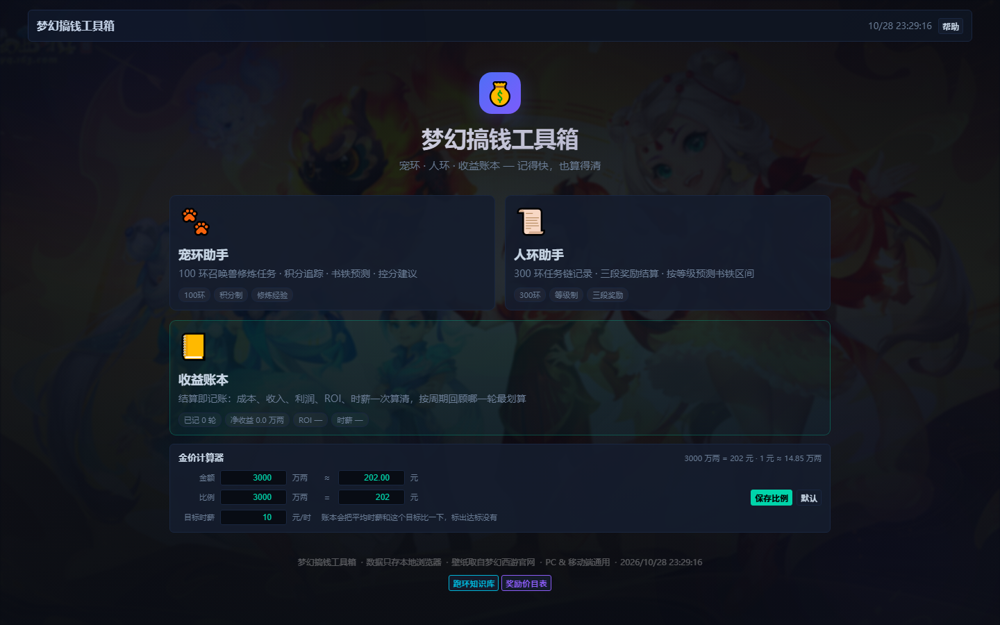
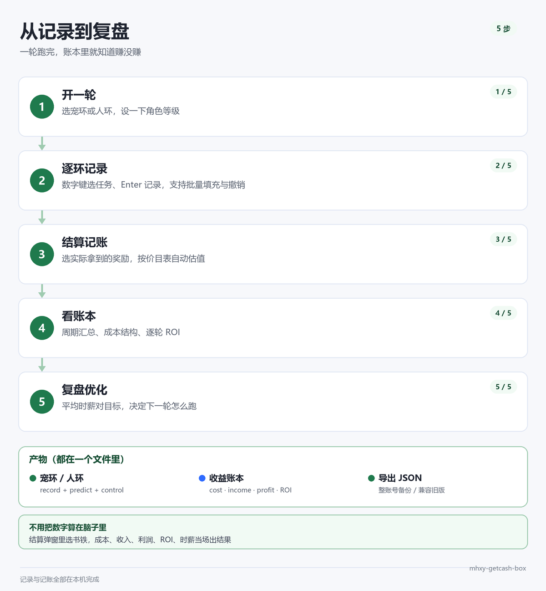

<p align="center"></p>

<p align="center">
  
  
  
  
</p>

---

## 1. 它是什么

梦幻西游的跑环记账工具，PC 单页版。宠环 100 环、人环 300 环逐环记录，结算时按价目表给奖励估值，直接算出这一轮的成本、收入、利润、ROI 和时薪。

整个项目就是一个 `index.html`（2158 行，原生 JS，无依赖、无构建），双击打开就能用。数据走浏览器 `localStorage`，不连服务器，不传任何东西出去。

举个实际算例：一轮 100 环按默认价累计成本 3773 万两，最后拿到 150 级制造指南书（参考价 5000 万两），结算那一刻就会给出利润 1227 万两、ROI 1 : 1.33、96 分钟折合时薪 818 万两。不用拿计算器按。

它不解决「该不该跑环」这种问题，只负责把已经跑完的这一轮算清楚。想知道今天整体赚没赚，看账本那页就够；想抠每一环花了多少，再回记录页翻格子。

## 2. 效果预览

首页：三张工具卡 + 金价计算器，一屏放下。



收益账本：周期切换、六张 KPI、成本结构条、逐轮明细。



宠环记录：顶部信息条实时算总分、书铁、经验、费用、用时。



外观设置：布局宽度、壁纸不透明度、壁纸模糊，改完即生效并记住。



每次打开会从官网壁纸里随机换一张；不想看壁纸就把不透明度拖到 0。



## 3. 功能

**记录**：宠环 100 环、人环 300 环都能逐环录，记任务类型、物品名和花费。边录边算总分、书铁等级、修炼经验、本轮费用和已用时长；宠环有预测页和控分页，人环按等级给三段奖励区间。批量填充、撤销、环号跳转、常用任务置顶、物品名 chips 都在。

**算账**：结算时选实际拿到的书铁或战魄，按价目表自动估值，额外奖励（修炼果、200 修炼点、3 级家具图）勾选即算钱，实时出成本、收入、利润、ROI、时薪。账本页按今日 / 7 天 / 30 天 / 本月 / 全部汇总，带成本结构条和逐轮明细；没记收入的老轮次标「未记账」，点进去补个数就进账。

**数据与外观**：多角色隔离，整账号导出 JSON，导入同时认 hub 旧版格式。右侧「设置」里切宽屏 1400 / 窄屏 1150，调壁纸不透明度和模糊，三项都记住。壁纸每次进入从官网 16 张里随机换。

**一轮的流程：**



## 4. 快速开始

| 方式 | 命令 | 说明 |
|---|---|---|
| 直接打开 | 双击 `index.html` | 最快，`file://` 下功能完整（含官网壁纸） |
| 本地服务 | `python -m http.server 8899` | 然后访问 `http://127.0.0.1:8899/index.html` |
| 跑测试 | `npm install` → `npm test` | 单测需要 Node 18+；冒烟与 UI 测试见第 8 节 |

第一次打开会有一个欢迎页，关掉就能用。数据在 `localStorage`，换浏览器或清缓存会丢，记得用「导出」备份。

## 5. 快捷键

| 按键 | 作用 |
|---|---|
| `1` ~ `9` | 选中快速栏第 1~9 个任务（按常用度排序后的顺序） |
| `Enter` | 记录当前选中的任务 |
| `←` `→` | 切换 记录 / 预测 / 控分 / 历史 / 统计 |
| `Esc` | 关闭最上层弹窗 |

输入框里打字时不触发。快速栏会按历史使用次数重排，录过的物品名会留成 chips，点一下回填。

## 6. 外观设置

右上角「设置」（首页、宠环、人环、账本都有），三项都存在 localStorage 的 `mhxy_view` 里：

| 项 | 范围 | 默认 |
|---|---|---|
| 布局宽度 | 宽屏 1400 / 窄屏 1150 | 1400 |
| 壁纸不透明度 | 0–100% | 52% |
| 壁纸模糊 | 0–12px | 1px |

壁纸来自梦幻西游官网的 16 张桌面壁纸，每次进入随机取一张，直接引用官网 CDN，不下载、不存仓库。网易 CDN 有防盗链（带本站 Referer 会 403），页面用 `<meta name="referrer" content="no-referrer">` 解决；加载失败自动退回纯色深色主题。不想看壁纸可加 `?noskin=1`。

## 7. 口径与实现

单测覆盖的就是这些规则，改公式前先看它们：

| 口径 | 规则 |
|---|---|
| 书铁等级 | `总分 + floor(等级/3) - 130`，向下取整到 10 的倍数，范围 80~150（80 是硬保底） |
| 修炼经验 | 每环经验表累加，满 100 环 751 点（不是 760，代码里表就是这个和） |
| 人环奖励区间 | 等级 ±10；≥140 固定 130~140；≥156 才有 150/战魄；≥110 才有灵饰 |
| 费用 | 用户显式设的价优先，设 0 就是免费，只有没设过才用默认价 |
| 账本 | 利润 = 收入 − 成本；ROI = 收入 ÷ 成本；时薪 = 利润 ÷ 用时（不足 5 分钟不给时薪） |
| 暂停 | 暂停时长记 `pausedMs`，结算按净时长算时薪 |

数据按角色分开存，`<uid>` 是角色 id。角色列表和当前角色是 `mhxy_users`、`mhxy_active`；宠环的配置、进行中、历史、单价是 `mhxy_{cfg,cur,runs,prices}_<uid>`，人环前面加个 `3`；奖励价目表单独一个 `mhxy_reward_prices_<uid>`；金价比例、点卡、目标时薪是全局的 `mhxy_money_cfg`；常用任务次数和物品名记忆是 `mhxy_task_usage_<uid>`、`mhxy_items_<uid>`；外观设置是 `mhxy_view`。

导出格式是 `{schemaVersion: 2, roles: [...], money}`；导入同时认这份新格式和 hub 旧版的单工具导出 `{type, cfg, hist, prices, cur}`。

## 8. 测试

```bash
npm install
npm test          # 18 项公式与账本口径单测（node --test）
npm run smoke     # 62 项行为冒烟（jsdom，走完整记录→结算→账本→补录→键盘→外观设置）
npm run ui        # 19 个视口的布局测试（真 Chrome，量尺寸与对齐）
```

单测只管数字：书铁公式、档位、经验 751、人环整十区间、0 价生效、奖励估值、人民币换算、有效工时、单轮与多轮汇总。它从 `index.html` 的 `@core` 区间抽纯函数跑，不启动浏览器，改公式先过这一关。

冒烟管流程：jsdom 真加载页面，从首页一路点到结算、账本、明细、导入旧格式、补录、价目表、金价、外观设置，62 项断言任何一步断链都会挂。

布局管尺寸：起本地服务加 Chrome CDP 直连，用 `getBoundingClientRect` 量 19 个视口，断言没有横向溢出、页面自身不滚动、首页一屏装下、金价三个输入框对齐、宽窄两档宽度正确。

`npm run ui -- --shots` 会把每个视口截图存到 `docs/screenshots`。

## 9. 目录

```
index.html                 单页应用，也是唯一运行文件
assets/readme/             README 首图与过程图
docs/screenshots/          UI 测试产出的截图
scripts/extract-core.js    从 index.html 抽 @core 区间给 Node 单测
tests/core.test.js         公式与账本单测
tests/smoke-dom.js         jsdom 行为冒烟
tests/ui-layout.js         Chrome 布局测试
移植规划-v0.1.md           从 hub / 小程序搬了什么的决策记录
```

## 10. 设计取舍

整个工具只有一个文件，为的是「拷一个 html 就能用」：不用装 Node，也不用起服务，双击、丢进任意静态目录都能跑。代价是文件长到 2158 行，所以把公式和账本计算圈进 `/* @core */` 区块，Node 测试直接把这段抽出来跑，不启动浏览器。

没有云同步和账号，是不想为了记个账去维护后端和登录态。换设备时导出 JSON 再导入，两个动作解决；代价是清浏览器数据前得自己记得备份。

分享海报和小程序数据互通这两块砍掉了。前者要额外维护一套 canvas 出图，后者要给两套导出结构写适配层，跟维护成本比起来都不划算。

壁纸不落地：仓库里不放图片，直接外链梦幻西游官网的 16 张原图。断网时背景退回纯色，功能不受影响。

宽窄两档是因为 2K 屏铺满时鼠标要横跨 2500px。1400 和 1150 都居中，两侧留边距，光标移动距离短一半。

## 11. 已知限制

- 数据只存在浏览器 localStorage，同一台机器同一个浏览器才有。浏览器清一次缓存（比如重装系统前）记录就没了，动手之前先在账本页点「导出」，把 JSON 存到别处
- 奖励价目表和物品单价是默认参考值，书、铁各 8 档覆盖 80~150 级。各服价格差得多，第一次用建议先按本区价格改一遍，再开始结算
- 人环三段奖励靠文字解析估值。自己手输的怪名字对不上价目表，会落到「其他」按 0 计，结算里可以在「自定义收入」补一笔
- 壁纸是外链官网 CDN 的 16 张 1920×1080 原图，断网时背景变成纯色，记录和账本不受影响
- 移动端只有 900px 和 400px 两个断点，没做触摸手势和长列表优化，手机上建议横屏用

## 12. 常见问题

**打开是空白页？**
确认用的是 Chrome / Edge 等现代浏览器；浏览器控制台若有报错，把报错贴出来。

**换电脑数据怎么搬？**
账本页右上角「导出」存一份 JSON，新机器打开后「导入」。

**旧数据（hub 版导出）能导进来吗？**
能。导入时认旧版 `{type, cfg, hist, prices, cur}`，历史轮次会标「未记账」，进账本点「补录」填个金额即可。

**壁纸没加载出来？**
断网或 CDN 不可达时不会显示，不影响功能；也可以加 `?noskin=1` 彻底关掉。

**数字算得和游戏里不一样？**
公式都在第 7 节，先核对角色等级和总分；奖励估值按价目表算，价目表可以自己改。

## 13. License

[MIT](LICENSE)
